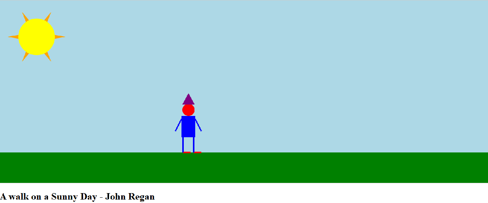

Assignment 1 - Hello World: GitHub and d3  
===

Using d3.js, I've created a canvas picturing a person standing out on a sunny day outside standing on grass using a mixture of rectangular, polygons, lines, and circles of different colors. 

Site Link  
===

See here: https://jahndevs.github.io/a1-ghd3/

Technical Achievements
===
- Animating the cloud movement across the canvas from left to right continuously.

Design Achievements 
===
- The sun with the sun rays around it making it realistic.
- Detailed person with multiple shapes to paint the scene.
